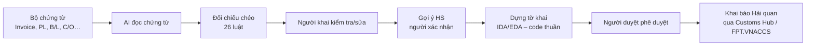
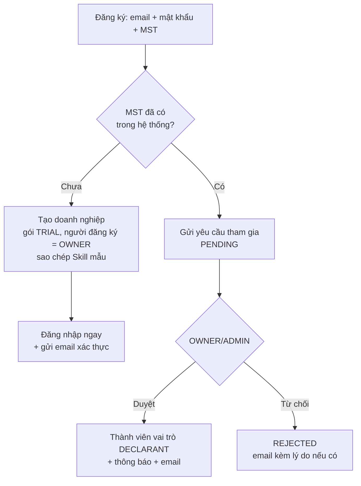
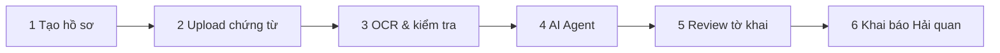
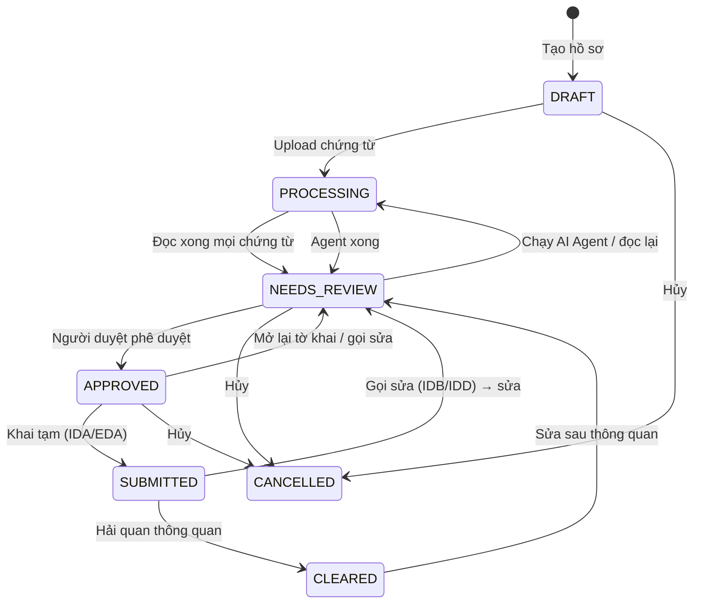
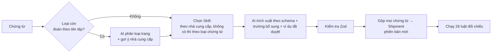
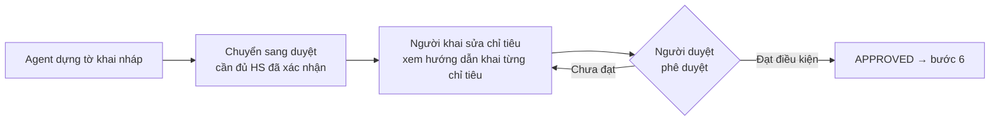
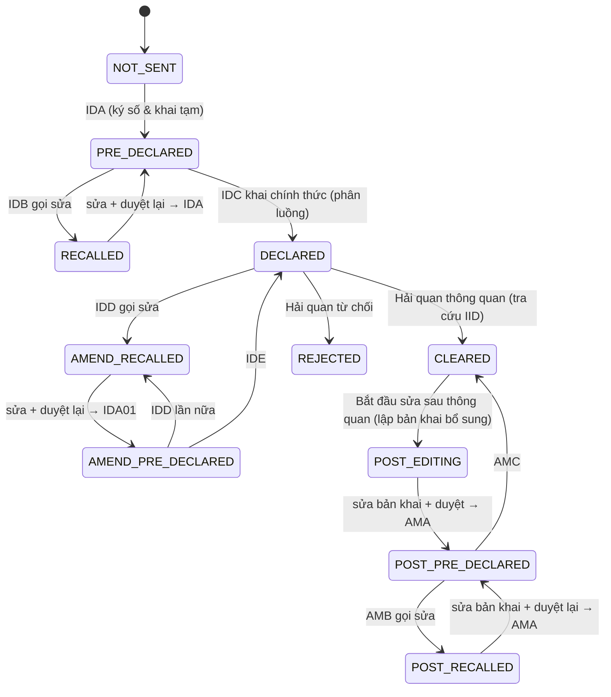

# Quy trình nghiệp vụ KhaiBáo AI

> Cập nhật 2026-10-21 theo code hiện tại (nhánh `main`). Tài liệu này mô tả **hệ thống đang chạy thế nào**. Định hướng sản phẩm: `docs/PRODUCT.md`; kiến trúc: `docs/ARCHITECTURE.md`; quyết định: `docs/adr/`.
> Căn cứ pháp lý chính: Phụ lục II TT39/2018/TT-BTC sửa đổi bởi TT121/2025/TT-BTC (hiệu lực 01/02/2026), CV 2061/TCHQ-GSQL.

## Mục lục

1. [Tổng quan](#1-tổng-quan)
2. [Doanh nghiệp, người dùng, vai trò](#2-doanh-nghiệp-người-dùng-vai-trò)
3. [Vòng đời hồ sơ – 6 bước](#3-vòng-đời-hồ-sơ--6-bước)
4. [Bước 1 – Tạo hồ sơ](#4-bước-1--tạo-hồ-sơ)
5. [Bước 2 – Upload chứng từ](#5-bước-2--upload-chứng-từ)
6. [Bước 3 – OCR & kiểm tra](#6-bước-3--ocr--kiểm-tra)
7. [Bước 4 – AI Agent: mã HS, dựng tờ khai, số hóa](#7-bước-4--ai-agent-mã-hs-dựng-tờ-khai-số-hóa)
8. [Bước 5 – Review & phê duyệt tờ khai](#8-bước-5--review--phê-duyệt-tờ-khai)
9. [Bước 6 – Khai báo Hải quan (12 nghiệp vụ)](#9-bước-6--khai-báo-hải-quan-12-nghiệp-vụ)
10. [Cấu hình doanh nghiệp](#10-cấu-hình-doanh-nghiệp)
11. [Gói dịch vụ & hạn mức](#11-gói-dịch-vụ--hạn-mức)
12. [Khu Quản trị hệ thống (đội vận hành)](#12-khu-quản-trị-hệ-thống-đội-vận-hành)
13. [Việc nền & thông báo](#13-việc-nền--thông-báo)
14. [Bất biến nghiệp vụ](#14-bất-biến-nghiệp-vụ)
15. [Chưa làm / hạn chế hiện tại](#15-chưa-làm--hạn-chế-hiện-tại)

---

## 1. Tổng quan

KhaiBáo AI đưa doanh nghiệp xuất nhập khẩu **tự khai báo** đi từ bộ chứng từ tới tờ khai Hải quan trong một luồng:

**Nguyên tắc:** AI chỉ **đọc chứng từ** và **gợi ý mã HS**. Đối chiếu, ánh xạ chỉ tiêu tờ khai, tính trị giá/thuế, quyết định chặn truyền là **code thuần có test** (ADR 0002).

## 2. Doanh nghiệp, người dùng, vai trò

### 2.1 Đăng ký và tham gia

- MST 10 hoặc 13 số; tên/địa chỉ điền sẵn từ tra cứu đăng ký thuế (hiện là adapter giả).
- Đăng ký tối đa 5 lần/IP/giờ. Đăng nhập: khóa 15 phút sau 10 lần sai (theo email + IP). Phiên 30 ngày, tự gia hạn khi còn < 15 ngày.
- Quên mật khẩu: tối đa 3 yêu cầu/email/giờ, luôn trả "đã gửi" (không lộ email có tồn tại).
- Mời thành viên: mọi vai trò trừ OWNER; lời mời hạn 7 ngày; người được mời đặt tên + mật khẩu là vào được.
- Yêu cầu tham gia (Cài đặt → Thành viên, chỉ OWNER/ADMIN thấy): **Duyệt** hoặc **Từ chối** (lý do không bắt buộc, ≤ 500 ký tự, gửi kèm email cho người xin). Chỉ xử lý được yêu cầu đang PENDING; bị từ chối thì đăng nhập báo "chưa thuộc doanh nghiệp nào".
- Chuyển quyền sở hữu: chỉ OWNER, cho thành viên **đang hoạt động** khác mình; phải nhập lại mật khẩu (sai 5 lần/15 phút → tạm khóa thao tác). Trong một transaction: người nhận → OWNER, chủ cũ → ADMIN (luôn đúng một OWNER); người nhận có thông báo + email. Phiên không phải đăng nhập lại – vai trò đọc lại ở mỗi request.

### 2.2 Vai trò

| Vai trò | Được làm |
|---|---|
| **OWNER** | Mọi việc (luôn qua kiểm quyền) |
| **ADMIN** | Quản lý thành viên, chứng thư số, tài khoản VNACCS, Skill AI, Mặc định khai báo, ngưỡng nghi ngờ, nguyên tắc 4 mắt + mọi việc của Nhân viên khai báo. **Không được phê duyệt tờ khai** |
| **DECLARANT** (Nhân viên khai báo) | Tạo/hủy hồ sơ, upload, sửa/xác nhận trường, chạy AI Agent, xác nhận HS, sửa chỉ tiêu tờ khai, chuyển sang duyệt, truyền và thực hiện các nghiệp vụ Hải quan |
| **APPROVER** (Người duyệt) | Phê duyệt tờ khai + mọi việc của Nhân viên khai báo |
| **VIEWER** | Chỉ xem |

- **Nguyên tắc 4 mắt** (cấu hình doanh nghiệp, mặc định tắt): người duyệt phải khác người tạo hồ sơ; OWNER được miễn.
- Không ai đổi được vai trò của OWNER, tự đổi vai trò mình, tự khóa mình.

### 2.3 Dữ liệu tách theo doanh nghiệp

Mọi bảng nghiệp vụ có `org_id` + Postgres Row-Level Security; file lưu theo `orgs/{orgId}/`. Người của doanh nghiệp này không đọc/ghi được dữ liệu doanh nghiệp khác (ADR 0004).

## 3. Vòng đời hồ sơ – 6 bước

**Trạng thái hồ sơ** và việc làm chuyển trạng thái:

- Hủy được khi chưa truyền (không phải SUBMITTED/CLEARED).
- Lùi bước luôn được; tiến tới bước 6 cần tờ khai đã duyệt; hồ sơ SUBMITTED/CLEARED/CANCELLED khóa đổi bước tay.
- **Hạn khai**: nhập khi tạo hồ sơ (mặc định hôm nay + 3), dùng để nhắc trên Tổng quan ("sắp hạn / quá hạn"), không chặn thao tác.

## 4. Bước 1 – Tạo hồ sơ

Người khai nhập:

| Thông tin | Ghi chú |
|---|---|
| Nhập khẩu / Xuất khẩu | Quyết định mẫu tờ khai: IDA (Mẫu 01) hay EDA (Mẫu 02) |
| Phương thức vận chuyển | 7 mã VNACCS: 1 không · 2 biển container · 3 biển hàng rời/lỏng (cả hàng LCL vào kho CFS) · 4 bộ · 5 sắt · 6 sông · 9 khác (chỉ tiêu 1.6/2.6) |
| Nhóm loại hình | Kinh doanh / Sản xuất xuất khẩu / Gia công / Chế xuất – lọc danh sách mã loại hình |
| Mã loại hình | A11, A12, E21, B11… |
| Cơ quan Hải quan | Chi cục đăng ký tờ khai |
| Đối tác nước ngoài, hạn khai, bộ Skill AI, ghi chú nội bộ | |

Không hỏi **điều kiện giao hàng** (lấy từ invoice ở bước OCR – dùng cho ô điều kiện giá, cộng cước/bảo hiểm, luật thiếu cước) và **phân loại cá nhân/tổ chức** (chỉ tiêu 1.7, lấy theo Mặc định khai báo, sửa ở bước Review). Hồ sơ cũ đã có điều kiện giao hàng vẫn hiện.

Mã hồ sơ tự sinh `HS-{NK|XK}-{YYMM}-{NNN}`. Tạo hồ sơ tính vào hạn mức hồ sơ/tháng của gói.

**Chứng từ gợi ý** (chỉ gợi ý, không chặn): Invoice, Packing List, Hợp đồng (tùy chọn); B/L (biển) hoặc AWB (không); hàng nhập thêm Arrival Notice, C/O (tùy chọn) và **hóa đơn cước (tùy chọn)** – cần khi giá EXW/FCA/FAS/FOB; thiếu cước thì luật đối chiếu ở bước OCR báo BLOCKER.

## 5. Bước 2 – Upload chứng từ

- Nhận PDF/PNG/JPG/ZIP; ≤ 25 MB/tệp, ≤ 60 trang/tệp, không nhận PDF có mật khẩu; ZIP tối đa 20 tệp bên trong.
- Tổng số trang của hồ sơ ≤ số trang/hồ sơ của gói.
- Loại chứng từ đoán sơ bộ theo tên tệp; AI phân loại lại ở bước đọc.
- Loại chứng từ: Invoice, Packing List, B/L, AWB, C/O, Hợp đồng, Arrival Notice, Hóa đơn cước, Khác.
- Trạng thái chứng từ: UPLOADING → QUEUED → READING → DONE / ERROR (đọc lại được khi ERROR). Xóa chứng từ → gộp lại dữ liệu lô hàng.

**Lấy chứng từ từ email (Hộp thư chứng từ, `/inbox` – ADR 0007).**
- Kết nối hộp thư ở Cài đặt › Tài khoản & tích hợp: Gmail hoặc Outlook qua OAuth, chỉ quyền đọc; token lưu mã hóa. Mọi vai trò trừ Người xem kết nối được; gỡ kết nối: người đã kết nối hoặc Quản trị / Chủ sở hữu.
- Bấm **Lấy chứng từ mới** → lấy email từ lần trước (lần đầu 30 ngày) có file PDF/PNG/JPG/ZIP và từ khóa chứng từ (invoice, packing, B/L, AWB, C/O, hóa đơn, chứng từ…); email đã lấy không lấy lại. Token bị thu hồi → hộp thư báo "Cần kết nối lại".
- File nằm ở hộp thư chứng từ, **chưa thuộc hồ sơ và chưa chạy AI**. Hệ thống gợi ý hồ sơ đang mở: trùng mã hồ sơ / số vận đơn trong tiêu đề hoặc tên file, hoặc cùng đối tác với người gửi.
- **Thêm vào hồ sơ**: chọn file + hồ sơ → file đi luồng tải chứng từ như trên (kiểm tra, quota, AI đọc). Hoặc **Tạo hồ sơ mới từ email**: mở trang tạo hồ sơ, tạo xong thì file chờ của email tự vào hồ sơ mới. Email hết file chờ → "Đã xếp"; email không liên quan → "Bỏ qua" (khôi phục được).

## 6. Bước 3 – OCR & kiểm tra

### 6.1 Đọc chứng từ

- Mỗi lần gọi AI ghi `usage_events` (token, chi phí).
- Lỗi dữ liệu → chứng từ ERROR; lỗi tạm (mạng, 429, 5xx) → thử lại tự động.

### 6.2 Trạng thái từng trường (ADR 0003 – theo tín hiệu, không theo % của model)

| Trạng thái | Nghĩa |
|---|---|
| CROSS_CHECKED | ≥ 2 chứng từ khớp nhau |
| SINGLE_SOURCE | Chỉ 1 nguồn |
| CONFLICT | Các chứng từ mâu thuẫn |
| INVALID_FORMAT | Sai định dạng (MST, ngày, số…) |
| MODEL_UNSURE | Model báo không chắc |
| USER_CONFIRMED | Người dùng đã sửa hoặc bấm "Đúng" |

**Ngưỡng nghi ngờ** (cấu hình doanh nghiệp): STRICT (đánh dấu cả SINGLE_SOURCE) · BALANCED (mặc định: CONFLICT, INVALID_FORMAT, MODEL_UNSURE) · RELAXED (chỉ CONFLICT, INVALID_FORMAT).

### 6.3 Người khai kiểm tra

- Màn chia đôi: chứng từ gốc bên trái (tô vị trí trường), kết quả bên phải theo nhóm.
- **Sửa** → USER_CONFIRMED; **Đúng** → USER_CONFIRMED; **Hoàn tác** → về giá trị AI đọc. Mỗi thao tác ghi `field_audit` (append-only), cập nhật dữ liệu lô hàng và chạy lại luật.
- Được đi tiếp khi còn trường nghi ngờ (chúng được đánh dấu trên tờ khai). Khóa sửa khi hồ sơ đã duyệt/truyền/hủy.
- Xuất **bảng đọc chứng từ** (Excel) theo từng chứng từ.

### 6.4 Luật đối chiếu chéo (26 luật)

Luật **BLOCKER = FAIL chặn phê duyệt và truyền**. Luật có ghi "NK" chỉ áp cho tờ khai nhập (tờ khai xuất hiển thị "Không áp dụng").

| Mức | Luật |
|---|---|
| **BLOCKER** | Tổng trị giá invoice = Σ dòng hàng · Tối đa 50 dòng/tờ khai (phải tách tờ khai) · Trị giá dòng ≤ 12 chữ số phần nguyên · Trọng lượng Packing List khớp vận đơn · Số chữ số tổng trọng lượng theo phương thức vận chuyển (không: 8+1, khác: 6+3) · Số kiện PL khớp vận đơn · Số kiện là số nguyên dương · Cước vận chuyển để cộng trị giá khi EXW/FCA/FAS/FOB (NK) · Điều kiện giao hàng có trong bảng mã (DPU chỉ tờ khai nhập) · Số AWB ≤ 20 ký tự · Danh sách container theo phương thức vận chuyển (tờ khai xuất hàng container phải có số container – TT121) · Mã nước đối tác ISO 2 ký tự · Hàng chương 84/85 khai MO/CU (CV 2061, NK) |
| **WARNING** | Số invoice trên chứng từ khác khớp · Đơn giá × số lượng = trị giá dòng (±1) · Số lượng ≤ 2 chữ số thập phân · Mô tả hàng ≤ 200 ký tự · Xuất xứ C/O khớp invoice · Phí bảo hiểm phù hợp điều kiện giao hàng (NK) · Cảng dỡ phải ở Việt Nam (NK) · Thứ tự ngày chứng từ (NK) · Tên/địa chỉ đối tác vừa ô khai · Hàng đóng chung container · Mã địa điểm lưu kho |
| **INFO** | Người mua trên invoice là doanh nghiệp theo MST (NK) · HS trên invoice chỉ tham khảo 6 số |

## 7. Bước 4 – AI Agent: mã HS, dựng tờ khai, số hóa

Người khai chọn **Tạo tờ khai** / **Số hóa chứng từ** / **Cả hai**:

| Việc | Làm gì | Ai làm |
|---|---|---|
| Tra cứu mã HS | Gửi HSCodePro theo lượt ≤ 50 dòng; nhận HS 8 số, lý do, cảnh báo, thuế NK (MFN/FTA theo C/O), VAT, tối đa 3 mã thay thế. AI có thể **hỏi lại** người khai; dòng lỗi → **Phân loại lại** | HSCodePro gợi ý – **người phải xác nhận** |
| Ánh xạ dữ liệu | Quy tắc chỉ tiêu Phụ lục II + Mặc định khai báo + ghi đè nguồn của doanh nghiệp; mỗi chỉ tiêu ghi nguồn gốc | Code |
| Dựng tờ khai | Tờ khai nháp mới (giữ chỉ tiêu người dùng đã sửa), trị giá tính thuế, khoản điều chỉnh, thuế dự kiến | Code |
| Số hóa chứng từ | Bản JSON chuẩn hóa của từng chứng từ để lưu/đính kèm | Code |

**Xác nhận HS** (bắt buộc từng dòng, 8 số theo biểu Việt Nam): chọn mã gợi ý, mã thay thế, mã trong biểu hoặc nhập tay. Thuế suất theo thứ tự: kết quả HSCodePro → biểu thuế nội bộ. Quy tắc thuế suất:
- Tờ khai xuất: 0/0. Loại hình E11/E21/E31/E41: miễn thuế NK, không thu VAT khâu nhập.
- Có C/O hợp lệ và biểu có thuế ưu đãi → thuế FTA, mã biểu thuế theo bảng TT39: ATIGA B04, ACFTA B05, AKFTA B06, AJCEP B09, VJEPA B10. EVFTA, VKFTA, CPTPP, RCEP chưa có mã trong văn bản đã đối chiếu → **chặn truyền** đến khi bổ sung bảng mã.
- Còn lại: MFN, biểu B01.

### 7.1 Ánh xạ chỉ tiêu tờ khai – các quy tắc đáng chú ý

| Chỉ tiêu | Quy tắc |
|---|---|
| 1.12/2.11 Người nhập/xuất khẩu | Theo MST tài khoản, không theo tên tiếng Anh trên chứng từ |
| Địa chỉ 4 dòng × 35 ký tự (vd 1.22) | Tự cắt ở khoảng trắng; người khai tự chia dòng trên form thì giữ đúng dòng đã nhập (form và dữ liệu gửi FPT dùng chung một hàm cắt) |
| 1.31/2.30 Phương tiện vận chuyển | Ô 1 hô hiệu (call sign) chỉ có khi đường biển/sông (PTVC 2/3/6): **điền sẵn 9999** (tàu chưa đăng ký trên hệ thống), B/L có hô hiệu thật thì sửa lại. Đổi sang phương thức khác → không gửi hô hiệu cũ |
| 1.33 Cảng dỡ | Cảng trên B/L là cảng chuyển tải nước ngoài → lấy điểm đến cuối tại Việt Nam |
| 1.37 Văn bản pháp quy | Hàng chương 84/85: **không tự điền**; để trống, chặn phê duyệt đến khi người khai chọn MO (mới) hoặc CU (đã qua sử dụng) |
| 1.39/2.34 Hình thức hóa đơn | 1 hóa đơn → A; nhiều hóa đơn / không có → B (kèm hướng dẫn bảng kê) |
| 1.43/2.38 Phương thức thanh toán | T/T, chuyển khoản → **KC** (ghi phương thức thực tế); TTR chỉ dùng cho chuyển tiền bồi hoàn; O/A → OA |
| 1.40/2.35 Số tiếp nhận hóa đơn điện tử | Chỉ có khi 1.39/2.34 = **D** (xét trên giá trị tờ khai): khi đó bắt buộc; đổi 1.39 sang mã khác → không gửi, không chặn, bỏ khi dựng lại |
| 1.53–1.62 / 2.44–2.52 Nộp thuế, hạn mức, bảo lãnh | Người khai nhập; 1.58/2.48 luôn hiện (tùy chọn). Hạn mức (1.54–1.57) và bảo lãnh (1.59–1.62) **khai cả nhóm**: nhập một ô thì các ô còn lại bắt buộc |
| 1.17–1.19, 1.24 / 2.16–2.18 Ủy thác, tại chỗ; 1.64; 1.65–1.67 / 2.54–2.56 | Người khai nhập, tùy chọn, không tự suy (hồ sơ không cho biết ủy thác/tại chỗ/kho ngoại quan/vận chuyển kết hợp); chỉ gửi FPT khi có giá trị |
| 1.44/2.39 Điều kiện giá | Chỉ lấy mã (bỏ địa danh); C&F/CNF chuẩn hóa; tờ khai xuất không có DPU |
| 1.44 ô 1 / 2.39 ô 4 Phân loại giá | Có dòng trị giá 0 (FOC) → C; toàn bộ FOC → B; không có hóa đơn → D (nhập) / không khai (xuất) |
| 1.48 Phí bảo hiểm | Điều kiện đã gồm bảo hiểm (CIF, CIP, C&I, DDU, DDP, DAP, DAF, DAT) → không cộng |
| 1.68 Phần ghi chú | Ghi số C/O trước (TT121), nhắc bổ sung ngày cấp; ≤ 100 ký tự |
| 2.24 Số vận đơn (xuất) | Là **số quản lý hàng hóa** do hệ thống cấp (Mẫu 14), không phải số B/L |
| 2.29 Địa điểm xếp hàng (xuất) | Bắt buộc, phải ở Việt Nam, không tự điền mặc định |
| 2.31 Ngày hàng đi (xuất) | Ngày B/L / ngày bay; không lấy ngày hàng đến |
| 2.69 Mô tả hàng (xuất) | Tự thêm "#&mã nước xuất xứ" khi truyền |

## 8. Bước 5 – Review & phê duyệt tờ khai

- Tờ khai hiện **giống bản in VNACCS** (mẫu in tờ khai nhập / xuất): các trang A4 theo đúng thứ tự vùng của mẫu, tiêu đề theo giai đoạn (bản nháp có chữ mờ "BẢN NHÁP – CHƯA KHAI HẢI QUAN"), số Hải quan trả về điền thẳng vào ô (khác số ước tính thì hiện cả hai). Chỉ tiêu không có chỗ trên mẫu nằm ở khối **Chỉ tiêu khác** dưới trang cuối.
- Ô lỗi Hải quan, ô bắt buộc còn trống, số ước tính và ô người khai đã sửa được đánh dấu ngay trên trang; nút **Chỉ ô cần xử lý (n)** nhảy lần lượt tới từng ô (số n cũng hiện trên tab "Tờ khai"). Lỗi Hải quan không gắn được vào ô nào hiện thành khung riêng (vị trí lỗi · nội dung → cách khắc phục) và vẫn tính vào n. Tờ khai chỉ đọc (đã khóa hoặc không có quyền sửa) không đếm ô còn thiếu, chỉ giữ ô lỗi Hải quan. **In / Lưu PDF** in đúng khổ A4 như mẫu, không lộ các dấu đánh dấu; ô mã chỉ in mã.
- Tên địa điểm lưu kho (do Hải quan trả về) được tra trước theo danh mục A202 từ mã kho người khai chọn, đánh dấu ước tính đến khi Hải quan trả tên.
- **Ô bắt buộc còn trống → khóa Phê duyệt**: khung "Còn N chỉ tiêu bắt buộc chưa nhập" liệt kê ô, nút **Đến ô cần xử lý** mở panel sửa ô. Bắt buộc = Phụ lục II (M, hoặc C khi tình huống áp dụng) + ô FPT.VNACCS bắt buộc mà người khai phải nhập; ô phần mềm tự điền và ô APP_* không tính. Một quy tắc chung (`@kb/contracts` `requiredGaps`) cho giao diện, mock và backend.
- Bấm một ô mở **panel sửa ô** bên phải: số và tên chỉ tiêu, **nhãn nguồn** (Invoice, B/L, C/O…, Người khai nhập), lý do có trên tờ khai, **hướng dẫn khai chỉ tiêu** trích Phụ lục II, lỗi Hải quan và cách khắc phục. Panel còn thay đổi chưa lưu mà chọn ô khác, đổi tab, Quay lại OCR, Xác nhận HS, Sang khai báo Hải quan hoặc Phê duyệt → hỏi Lưu / Bỏ thay đổi / Ở lại. Ô theo chứng từ có nút sang bước OCR.
- Sửa tay: ghi `field_audit`, giữ qua các lần dựng lại; không sửa tay được số tờ khai, mã loại hình và các chỉ tiêu trị giá/cước/tỷ giá (sửa ở bước 3 rồi dựng lại); kiểm định dạng và độ dài theo danh mục chỉ tiêu.
- **Tỷ giá tính thuế**: tỷ giá mua chuyển khoản Vietcombank lấy tối thứ Năm, áp cho tờ khai đăng ký từ thứ Hai tuần sau. Tờ khai dựng tuần trước sẽ bị chặn khai tạm khi đã sang tuần tỷ giá mới (mở lại để dựng lại).
- Incoterm EXW/FCA/FAS/FOB hiển thị rõ cước, bảo hiểm, phí nước ngoài cộng vào trị giá tính thuế và nguồn từng khoản; phí nội địa (THC, D/O, CFS, lưu kho) không cộng.

**Điều kiện phê duyệt** (theo thứ tự): vai trò APPROVER hoặc OWNER → tờ khai đang là bản nháp → không còn luật BLOCKER = FAIL → đủ HS đã xác nhận → có tỷ giá → đúng nguyên tắc 4 mắt (nếu bật) → đã chọn MO/CU cho hàng chương 84/85 → không còn chỉ tiêu bắt buộc trống.

**Mở lại tờ khai**: được khi đã duyệt mà chưa truyền, hoặc truyền bị từ chối trước khi có số tờ khai. Đã có số tờ khai thì phải dùng nghiệp vụ gọi sửa ở bước 6.

## 9. Bước 6 – Khai báo Hải quan (12 nghiệp vụ)

Màn sắp theo **dòng đời tờ khai**: đầu trang là số tờ khai, phân luồng và nút **Tra cứu trạng thái**; khung **Việc tiếp theo** gợi ý nút chính; bên dưới là 4 giai đoạn. Nút chỉ bấm được đúng lúc, nút khóa có ghi lý do.

| Giai đoạn | Nghiệp vụ (nhập / xuất) | Ý nghĩa |
|---|---|---|
| ① Khai báo tờ khai | **IDA**/EDA → **IDB**/EDB → **IDC**/EDC | Khai tạm (nhận số tờ khai, thuế dự kiến) → gọi sửa khai tạm nếu cần → khai chính thức (phân luồng) |
| ② Sửa đổi bổ sung (trước thông quan) | **IDD**/EDD → **IDA01**/EDA01 → **IDE**/EDE | Gọi tờ khai đã phân luồng về → khai tạm sửa đổi → khai chính thức sửa đổi |
| ③ Sửa đổi sau thông quan | **AMA** → **AMB** → **AMC** | Bản khai bổ sung riêng (tờ khai gốc giữ nguyên): khai tạm → gọi sửa bản khai tạm → khai chính thức (trong 60 ngày – TT121 Điều 20) |
| ④ Chứng từ & cảng | **HYS** · **Container qua KVGS** · **Lệ phí cảng biển** | Số hóa chứng từ · đưa container qua khu vực giám sát · nộp lệ phí cảng biển |
| Đầu trang | **IID** / IEX | Tra cứu trạng thái tờ khai, dùng mọi lúc khi đã có số tờ khai |

### 9.1 Chuyển giai đoạn

### 9.2 Quy tắc

- **Ký số & khai tạm (IDA)** chỉ gửi khai tạm. Người khai xem số tờ khai + thuế dự kiến rồi tự bấm **Khai chính thức (IDC)**.
- **Gọi sửa** (IDB, IDD): có hộp thoại xác nhận; thành công thì tờ khai **mở lại ở bước Review** (bản nháp). Người khai sửa chỉ tiêu, Người duyệt phê duyệt lại, rồi mới gửi được nghiệp vụ nội dung tiếp theo (IDA, IDA01).
- **Sửa sau thông quan (AMA)** là bản khai riêng, **không sửa tờ khai gốc** (tờ khai gốc khóa toàn bộ). Chỉ khi tờ khai đã thông quan, hồ sơ có thêm **bước 7 "Sửa sau thông quan"** (bước 6 có thẻ lối vào); mọi việc AMA nằm ở đó, theo 4 bước nhỏ: ① **Chọn dòng** của tờ khai gốc cần sửa → ② **Sửa nội dung**: bảng so sánh Trước (theo tờ khai gốc + số Hải quan trả về, chỉ đọc) | Sau (sửa được), ô đã đổi được đánh dấu, tiền thuế "Sau" tự tính (thuế XNK = trị giá × thuế suất, GTGT = (trị giá + thuế XNK + thu khác) × thuế suất; sửa tay thì giữ); mô tả/xuất xứ và thuế – thu khác thu gọn → ③ **Lý do & phê duyệt**: hiện sẵn mã lý do khai bổ sung (1–6) + ghi chú sau; các ô khác (nộp thuế, ngân hàng, bảo lãnh, tỷ giá sau, người khai, hợp đồng gia công) trong "Thông tin khác"; Người duyệt phê duyệt (4 mắt) → ④ **Khai Hải quan**: một nút chính (khai tạm AMA, rồi khai chính thức AMC), **AMB** gọi bản khai về là nút phụ (gọi về xong tự về ②); sau AMC bản khai khóa, có thể lập bản khai bổ sung lần tiếp theo. Đầu bước 7 hiện hạn 60 ngày (ngày cấp phép + 60). Mọi lần sửa ô ghi field_audit. Đặc tả: `docs/superpowers/specs/2026-10-19-ama-khai-bo-sung-sau-thong-quan-design.md` (nghiệp vụ), `docs/superpowers/specs/2026-10-20-ama-sau-thong-quan-redesign-design.md` (giao diện).
- Nghiệp vụ gửi nội dung (IDA, IDA01) luôn kiểm: đã duyệt, HS đủ, không còn BLOCKER, **không còn ô bắt buộc trống** (kiểm lại ngay lúc Ký số & khai tạm), không còn lỗi chặn khi dựng dữ liệu FPT, tỷ giá đúng tuần (IDA). Backend từ chối trước khi đánh dấu tờ khai đã khai. AMA kiểm: bản khai bổ sung đã duyệt, có dòng hàng, có mã lý do.
- **Chặn truyền** (lỗi dựng dữ liệu FPT): thiếu MO/CU cho hàng 84/85; thiếu mã biểu thuế FTA; khoản điều chỉnh trị giá (ngoài cước/bảo hiểm) chưa gửi được ở chỉ tiêu 1.49; tờ khai xuất thiếu xuất xứ dòng hàng; thông điệp sai đặc tả FPT (trước đây chỉ ghi log, nay chặn).
- Sau **IDC/IDE** hệ thống tự **hỏi trạng thái** (IID nhập / IEX xuất) tới khi thông quan hoặc bị từ chối.
- Đang chờ phản hồi một nghiệp vụ thì các nút khác khóa.
- **Không gửi trùng** (ADR 0005): mỗi nghiệp vụ một dòng outbox có khóa idempotency; **Gửi lại** luôn tra trạng thái trước, Hải quan đã ghi nhận thì không gửi.
- Mọi thông điệp gửi/nhận lưu ở **Nhật ký thông điệp** (đã che MST, mật khẩu) làm hồ sơ pháp lý.
- Kết nối FPT.VNACCS thật hiện hỗ trợ IDA/IDC/EDA/EDC, HYS, AMA (payload theo VNACCS_AMA v1.3; đường dẫn /api/AMA và vị trí số tờ khai bổ sung trong phản hồi là suy luận, cần đối chiếu) và tra cứu. Các nghiệp vụ còn lại báo "chưa kết nối FPT" cho tới khi có đặc tả API. Môi trường dev/demo dùng cổng giả lập đủ 12 nghiệp vụ.

Chi tiết thiết kế: `docs/superpowers/specs/2026-10-15-luong-nghiep-vu-hai-quan-design.md`.

## 10. Cấu hình doanh nghiệp

Menu **Tài khoản & tích hợp**:

| Tab | Nội dung | Ai sửa |
|---|---|---|
| Doanh nghiệp | Thông tin doanh nghiệp (MST khóa) | OWNER/ADMIN |
| Gói & sử dụng | Gói, số hồ sơ/trang đã dùng trong tháng, chi phí AI | Xem |
| Thành viên & vai trò | Mời, đổi vai trò, khóa; duyệt yêu cầu tham gia | OWNER/ADMIN |
| Kết nối hệ thống | Trạng thái HSCodePro, Customs Hub, dịch vụ AI; kiểm tra kết nối | OWNER/ADMIN |
| Chứng thư số | Thêm, đặt mặc định, xóa; nhắc trước 30 ngày khi sắp hết hạn | OWNER/ADMIN |
| Khai báo | **Mặc định khai báo** theo NK/XK (loại hình, chi cục, kho, PTTT…), **ghi đè nguồn** từng chỉ tiêu trong phạm vi cho phép; **tài khoản VNACCS** (lưu mã hóa, không bao giờ trả mật khẩu về trình duyệt) | OWNER/ADMIN |
| Ngưỡng & giao diện | Ngưỡng nghi ngờ, nguyên tắc 4 mắt, giao diện | OWNER/ADMIN |

**Ứng dụng máy tính (PWA)**: web có manifest (`app/manifest.ts`, icon `public/icons/`) nên Chrome/Edge cài được thành ứng dụng (cửa sổ riêng, icon trên màn hình/thanh tác vụ, tự cập nhật theo bản web); Safari: Tệp → Thêm vào Dock. Lối vào: menu người dùng → "Cài đặt ứng dụng" và thẻ "Ứng dụng trên máy tính" ở tab Ngưỡng & giao diện. Chưa có service worker – không chạy ngoại tuyến.

**Danh mục hàng hóa** (menu riêng, `/products`): mặt hàng doanh nghiệp đã khai kèm mã HS – để tra lại HS cho hàng đã khai thay vì gọi HSCodePro (phần khớp hàng khi dựng tờ khai: làm sau).
- Mỗi mặt hàng một dòng, khóa theo **mã hàng** (không phân biệt hoa thường); không có mã hàng thì theo **tên chuẩn hóa** (chữ thường, gộp khoảng trắng, bỏ "(Hàng) mới 100%" ở cuối). Lưu: mã hàng, tên, mô tả hàng hóa (chi tiết, giúp phân loại HS), mã HS 8 số, ĐVT + ĐVT 2, xuất xứ, biểu thuế, thuế suất NK/VAT/BVMT/TTĐB/tự vệ/PBĐX, đơn giá + mã tiền và đối tác của lần khai gần nhất, ghi chú, số lần khai, tờ khai gần nhất (số, ngày, mã loại hình), nguồn (Import / Thêm tay / Từ tờ khai), dòng gốc trong file import.
- **Import Excel**: bảng kê dòng hàng đã khai (mỗi dòng một dòng hàng của tờ khai; cần cột "Tên hàng", "Mã HS"; nhận cột theo tên, không phân biệt dấu; file chỉ có "Mô tả hàng hóa" thì dùng cột đó làm tên, có cả hai thì cột mô tả thành mô tả chi tiết). Bảng tự ẩn cột ĐVT 2 / đơn giá / đối tác / thuế suất phụ khi cả danh mục không có dữ liệu (bật lại ở nút "Cột"). Trình duyệt đọc + gộp theo mặt hàng, xem trước (số mặt hàng, dòng bị bỏ qua, mặt hàng khai với nhiều mã HS) rồi gửi từng lô 500. Cột mã hàng trống → lấy dãy số ngay trước "(Hàng) mới 100%" trong tên (vd `…, 145612. Hàng mới 100%`). Mặt hàng đã có: bản import có tờ khai mới hơn thì ghi đè, cũ hơn chỉ điền ô trống; số lần khai lấy giá trị lớn nhất (import lại cùng file không cộng dồn).
- **Tự thêm khi tờ khai được duyệt**: dòng hàng có HS đã xác nhận → mặt hàng mới thêm vào (nguồn "Từ tờ khai"); mặt hàng đã có (khớp theo tên chuẩn hóa, kể cả mặt hàng có mã hàng) tăng số lần khai + cập nhật lần khai gần nhất (đơn giá, mã tiền, đối tác), **giữ nguyên mã HS trong danh mục**.
- Quyền: Người khai / Quản trị / Chủ sở hữu thêm, sửa, xóa (cả xóa nhiều), import; Người duyệt / Người xem chỉ xem.

**Cấu hình Skill AI**: mỗi Skill là cách đọc một loại chứng từ (DOCUMENT) hoặc một nhà cung cấp (SUPPLIER).
- Trường chuẩn bật/tắt (không xóa được), tối đa 20 trường bổ sung do doanh nghiệp định nghĩa (AI đọc thật).
- Mỗi lần sửa trường tạo phiên bản mới.
- Chứng từ mẫu: AI đọc nháp nhãn → người xác nhận.
- **Đánh giá lại** cần ≥ 5 mẫu đã gắn nhãn, đo độ chính xác từng trường.

## 11. Gói dịch vụ & hạn mức

| Gói | Hồ sơ/tháng | Trang/hồ sơ | Giá (VND/tháng) |
|---|---|---|---|
| TRIAL | 10 | 20 | 0 |
| BASIC | 50 | 30 | 990.000 |
| PRO | 150 | 40 | 2.990.000 |
| ENTERPRISE | 1.000 | 100 | Theo hợp đồng |

- Tạo hồ sơ vượt số hồ sơ/tháng (gồm cả phần thưởng thêm trong tháng do đội vận hành cấp) hoặc upload vượt số trang/hồ sơ → `QUOTA_EXCEEDED`.
- Kỳ tính theo tháng dương lịch. Mọi lần gọi dịch vụ trả phí ghi `usage_events` theo doanh nghiệp (cột `provider`, `kind`; số lượng + nghiệp vụ + đơn giá trong `meta`):

| Nhà cung cấp | `kind` | Khi nào ghi | Chi phí |
|---|---|---|---|
| AI (đọc chứng từ) | `AI_CLASSIFY`, `AI_EXTRACT` | Mỗi lần gọi model | Token × giá model (USD) × tỷ giá `AI_USD_VND_RATE` |
| HSCodePro | `HS_CLASSIFY` | Tạo lượt phân loại / phân loại lại được HSCodePro nhận (số dòng gửi) | `HSCODEPRO_PRICE_PER_ITEM_VND` × số dòng |
| HSCodePro | `HS_ANSWER` | Gửi câu trả lời cho một dòng thành công (409 "đã gửi" khi job chạy lại không ghi) | `HSCODEPRO_PRICE_PER_ITEM_VND` × 1 |
| HSCodePro | `HS_RESULT` | Lượt hỏi kết quả có dòng vừa có kết quả (hỏi 3 giây/lần mà chưa xong thì không ghi) | 0 – dòng đã tính lúc gửi |
| Customs Hub | `CUSTOMS_SEND` | Mỗi nghiệp vụ (IDA, IDC, HYS, IDB…) được cổng trả lời, kể cả bị Hải quan từ chối | `CUSTOMS_HUB_PRICE_PER_MESSAGE_VND` × 1 |
| Customs Hub | `CUSTOMS_QUERY` | Mỗi lần hỏi trạng thái IID/IEX (job `customs-poll`, nút Tra cứu, tra trước khi Gửi lại) | `CUSTOMS_HUB_PRICE_PER_MESSAGE_VND` × 1 |

- Đơn giá HSCodePro / Customs Hub đặt trong biến môi trường (chuỗi thập phân VND; chưa có giá hợp đồng → để trống = 0). Tiền tính bằng Decimal.
- Không tính trùng: `CUSTOMS_SEND` khóa theo `idempotencyKey` của outbox (job chạy lại sau crash gửi lại cùng thông điệp chỉ ghi một lần; "Gửi lại" tạo outbox mới = thông điệp mới); lỗi tạm (mạng/5xx) và nghiệp vụ cổng chưa hỗ trợ (chưa gửi được) không ghi. `HS_CLASSIFY` khóa theo mã lượt HSCodePro.
- Ghi chi phí là "cố gắng hết sức": ghi lỗi chỉ log `[usage]`, không làm hỏng nghiệp vụ đã gửi.
- Tab **Gói & sử dụng** hiện chi phí tháng tách AI / HSCodePro / Customs Hub (tất cả do KhaiBáo AI chịu theo gói). Báo cáo **Sử dụng & chi phí** của đội vận hành tách giá vốn theo nhà cung cấp, kèm số lệnh gọi AI, số dòng gửi HSCodePro, số thông điệp Customs Hub.

## 12. Khu Quản trị hệ thống (đội vận hành)

Khu `/admin` dành cho đội vận hành KhaiBáo AI, nhìn xuyên doanh nghiệp nhưng **chỉ số liệu tổng hợp** (ADR 0006). Bắt buộc **2FA (TOTP)**; mọi thao tác ghi nhật ký kiểm toán.

| Vai trò | Quyền |
|---|---|
| SUPER_ADMIN | Xem, hỗ trợ, gói & thanh toán, nền tảng, nhân sự |
| SUPPORT | Xem, hỗ trợ |
| READONLY | Xem |

Chức năng: tổng quan "Cần chú ý" (vượt hạn mức, gói sắp hết hạn, lỗi tích hợp, job lỗi, yêu cầu tham gia chờ, lấy tỷ giá lỗi) · doanh nghiệp (tạm khóa/mở, đổi gói, cấp thêm hạn mức, gia hạn dùng thử) · người dùng (khóa/mở, gửi lại email, thu hồi phiên) · gói · báo cáo sử dụng/biên lợi nhuận · tích hợp nền tảng (khóa API) · sức khỏe hệ thống và job lỗi (chạy lại) · Skill mẫu · thông báo hệ thống · **tỷ giá tính thuế** (sửa tay có lý do) · nhân sự · nhật ký kiểm toán.

## 13. Việc nền & thông báo

**Việc nền (BullMQ, worker):**

| Job | Việc |
|---|---|
| `extract-document` | Đọc một chứng từ (hoặc chỉ gộp lại) |
| `run-agent` | Chạy các việc của AI Agent |
| `hs-poll`, `hs-answer`, `hs-reclassify` | Theo dõi / trả lời / phân loại lại mã HS với HSCodePro (hỏi mỗi 3 giây, tối đa 15 phút); ghi chi phí HSCodePro (§11) |
| `customs-send`, `customs-poll` | Gửi một nghiệp vụ Hải quan; hỏi trạng thái tới khi thông quan; ghi chi phí Customs Hub mỗi thông điệp thật sự gửi (§11) |
| `skill-sample-read`, `skill-evaluate` | Đọc nháp nhãn mẫu; đánh giá độ chính xác Skill |
| `cert-expiry` | Hằng ngày: nhắc chứng thư số sắp hết hạn |
| `exchange-rate-weekly` | Thứ Năm 23:30 giờ VN: lấy tỷ giá Vietcombank (thử lại mỗi 30 phút) |

**Thông báo trong ứng dụng:**

| Sự kiện | Gửi cho |
|---|---|
| Yêu cầu tham gia / được duyệt | OWNER, ADMIN / người yêu cầu (kèm email) |
| Đọc xong mọi chứng từ, Agent xong, tờ khai được duyệt | Người tạo hồ sơ |
| Hồ sơ chờ phê duyệt | APPROVER, OWNER |
| Kết quả phân luồng, đã thông quan | Người tạo hồ sơ + APPROVER |
| Gọi tờ khai về sửa, nghiệp vụ bị từ chối | Người tạo hồ sơ |
| Chứng thư số sắp hết hạn | OWNER, ADMIN |
| Thông báo hệ thống của đội vận hành | Thành viên các doanh nghiệp được chọn |

## 14. Bất biến nghiệp vụ

1. Mọi truy vấn/ghi dữ liệu nghiệp vụ có `orgId`.
2. Mã định danh (MST, MAWB, HAWB, số invoice/C/O/container, HS) là chuỗi.
3. Tiền/trị giá tính bằng `Decimal`.
4. Ngày nghiệp vụ `YYYY-MM-DD`; thời điểm UTC.
5. AI chỉ đọc chứng từ và gợi ý HS; đối chiếu, ánh xạ, thuế, chặn truyền là code thuần có test.
6. Người dùng sửa trường → ghi `field_audit` append-only.
7. Không truyền tờ khai khi còn BLOCKER FAIL hoặc HS chưa xác nhận.
8. Mọi lần gọi AI, HSCodePro, Customs Hub ghi `usage_events`.
9. Dữ liệu từ ngoài (HTTP, form, AI, file, queue) kiểm bằng Zod trước khi dùng.

## 15. Chưa làm / hạn chế hiện tại

| Mảng | Hiện trạng |
|---|---|
| Kết nối FPT.VNACCS | Chưa có đặc tả API cho IDB, IDD, IDA01, IDE, AMB, AMC, container qua KVGS, lệ phí cảng biển; AMA đã ánh xạ nhưng đường dẫn API và vỏ phản hồi chưa đối chiếu với FPT |
| AMA – tự tính thuế "Sau" | Chỉ thuế XNK và GTGT theo %; thuế tuyệt đối, TTĐB, BVMT, chống bán phá giá người khai nhập tiền thuế |
| Bảng mã biểu thuế | Chưa có mã cho EVFTA, VKFTA, CPTPP, RCEP (TT121 dẫn chiếu bảng mã trên website Cục Hải quan) |
| Khoản điều chỉnh trị giá 1.49 | Chưa gửi được sang FPT (chặn truyền nếu có) |
| Số quản lý hàng hóa (tờ khai xuất, Mẫu 14) | Chưa lấy tự động; người khai nhập tay |
| Hàng LCL qua kho CFS | Hai văn bản hướng dẫn khác nhau (TT39: mã 3; CV 6376: mã 2) – cần chốt |
| Đọc chứng từ | Chưa đọc lớp chữ PDF / XML hóa đơn điện tử; mọi chứng từ gửi AI |
| Tài khoản | Xác thực email chưa bắt buộc khi đăng nhập; chưa có trang xác thực email / đặt lại mật khẩu / nhận lời mời; người bị từ chối tham gia chỉ nhận email (chưa có màn báo trạng thái), chuyển quyền sở hữu chưa ghi nhật ký kiểm toán riêng; tra cứu MST là giả lập |
| Hộp thư chứng từ | Chưa tự lấy định kỳ; chưa nhận XML hóa đơn điện tử; chưa tự tạo hồ sơ từ email; gmail.readonly cần Google verification + CASA khi mở công khai (Testing tối đa 100 người dùng) |
| Danh mục hàng hóa | Chưa dùng danh mục khi dựng tờ khai (khớp hàng → lấy HS, bỏ qua HSCodePro); mặt hàng tự thêm khi duyệt chưa có số tờ khai (số chỉ có sau khi truyền); duyệt lại tờ khai đã mở lại sẽ tăng số lần khai thêm lần nữa |
| Chi phí | HSCodePro và Customs Hub ghi theo đơn giá cấu hình (mặc định 0 – chưa có giá hợp đồng); chưa có lịch sử giá theo thời gian (đổi đơn giá không tính lại sự kiện cũ) |
| Khác | Hủy tờ khai (Mẫu 06), tách vận đơn (Mẫu 12), khai danh sách container qua HYS, đóng chung container nhiều tờ khai xuất (Mẫu 15); đại lý khai hộ nhiều doanh nghiệp; app mobile |
